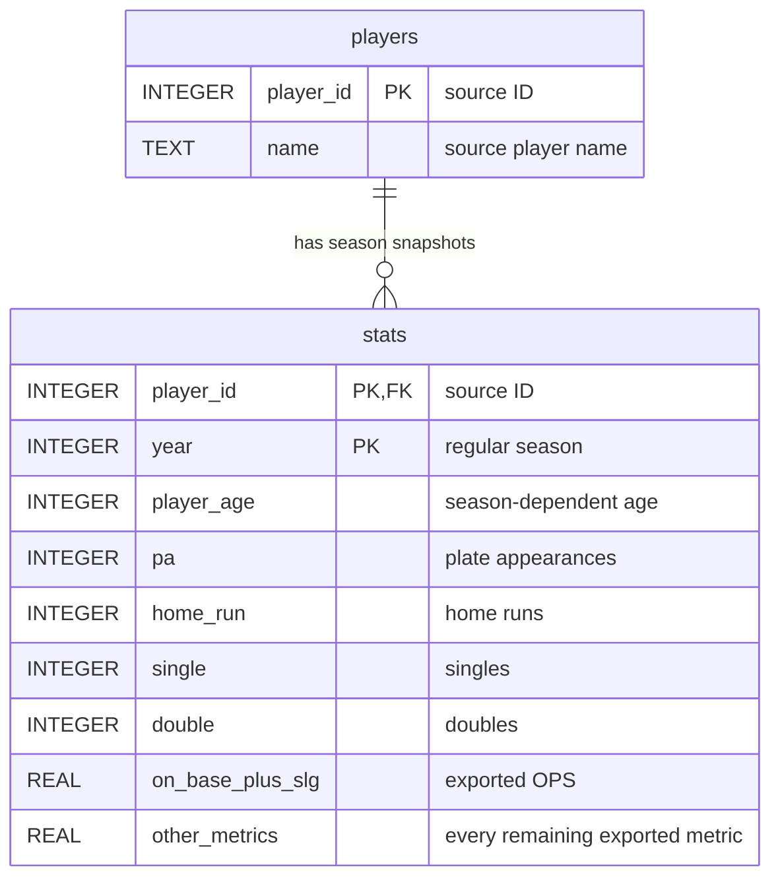

# Evaluation and assignment evidence

The dataset is a fixed snapshot with 1,879 player-seasons, 857 source player IDs,
49 exported fields, and seasons 2024–2026. Source SHA-256:
`60de4620c5e90e112a1c1142cd1504af42e46ece8ba816a1d21ea530a6b318ca`.
The CSV's ten-plate-appearance filter limits coverage. Retrieval dates and source
filter settings beyond that verified coverage are unavailable and are not inferred.



The diagram abbreviates the metric columns: `internal/data/data.go` contains the
complete catalog. The composite statistics primary key prevents splitting or
merging a player-season accidentally. Names are not identity keys. Counts use
integers; rates and advanced metrics use real numbers without import rounding.
Exact source decimal lexemes remain in the checksum-verified CSV. Serving opens
read-only connections; importing runs separately and replaces the snapshot
atomically. See the README for import, configuration, and startup commands.

## Reproducible offline checks

```sh
go test ./...
go test -race ./...
go vet ./...
go test -v -run TestTwelveHeldOutCasesThroughPublicWorkflow .
```

The unified harness reads all twelve questions from
`evaluation/reference-answers.json` and sends them through the public HTTP
workflow, real SQLite, and controlled local OpenAI SDK responses. Reference values
are held-out literals independently checked with Decimal and SQLite during data
profiling, separate from prompt examples. Retrieved table values and supported
answer facts are checked in separate subtests. The controlled model demonstrates
workflow behavior; it does not establish live model accuracy.

Other HTTP tests cover exactly 500 versus overflow rows, truncation, count queries
across all rows, exported-rate ties, filtering before ranking, confirmation and
revision, correction exhaustion, failed answer generation, and independent
comparison success/failure. Private file routes return 404 because the server only
embeds the browser page and registers the public question endpoint.

## Private records and explicit live evaluation

Set `evaluation_file` to `.private/evaluation.jsonl` to opt in to developer records.
The default is disabled. Each completed request appends one JSON line with time,
question, strategy-specific planning/execution/answer events, generated SQL,
retrieved rows, final text, and the public outcome. Clarifications and unsupported
outcomes are recorded even when no query runs. Failed stages are marked; records
omit raw provider errors and credentials. The configured API key is redacted
from every serialized field, including unexpected model output. Developer errors remain in the separate
private log. Directories are created with mode 0700 and the record file uses 0600.
Records can contain users' questions and must stay outside externally configured
file servers. Concurrent requests append complete records under a mutex.

Live evaluation is optional, explicitly requested by a command, and incurs model
charges. Import the fixed CSV first. Configure the administrator's model, database,
and a private `evaluation_file`, then set `OPENAI_API_KEY` by your normal secret
management process. Run:

```sh
go test -v -run '^TestLiveReferenceEvaluation$' . -args -live-config /absolute/path/to/config.json
```

The runner uses the configured model and database with both prompting strategies.
Its reference values apply only to a database imported from the checksum-identified
CSV above. The runner does not verify database provenance; independently confirm
that the configured database is this fixed import before interpreting its report.
It does not run when the config flag is absent. It writes private event records
and a separate `.review.jsonl` report pairing each reference with the actual public
outcome. Compare retrieved values against reference player identity, season,
qualification, counts and ties separately from answer wording. Permit equivalent
SQL, column projections and row order; require the same facts. Review prose for
season disclosure, empty-result handling, grounding and lack of invented claims.
Shared ambiguity cases correctly stop for confirmation instead of evaluating
conflicting interpretations. Mark the two review fields only after review;
the runner reports pending review rather than inventing accuracy scores.

No live calls were made during this implementation. There are no observations
about live accuracy or a claim that examples improve the configured model. The
controlled suite verifies that both strategies use the same model, dataset and
rules, and that a failed strategy preserves the other's successful answer. A live
report should record model identifier, snapshot checksum, date, retrieval accuracy,
wording faithfulness, failures, and differences between strategies.

## Six additional demo examples

These supplement the initial home-run/OPS/overlap questions. Values below describe
the fixed source and controlled verification, rather than unrun live outputs.

| Question | Expected demonstration |
| --- | --- |
| Which qualifying players share tenth place by dense rank for home runs in 2024? | Pete Alonso and Cal Raleigh both have 34; both appear. |
| What was Luis Vázquez's OPS in 2025? | OPS 0.448 and 53 plate appearances; qualification is unnecessary for this lookup. |
| How many players had at least 502 plate appearances in each available season? | 129 in 2024, 145 in 2025, and 135 in 2026. |
| Which qualifying players hit more than 100 home runs in 2026? | Normal empty answer, rather than an application failure. |
| What was Max Muncy's OPS in 2026? | Clarification distinguishes two players before querying. |
| What was Alec Bohm's average best speed in 2024? | Preserve the exported value 100.768220847. |

For an unsuccessful example, controlled provider failures produce a plain-language
error without a table; rejected queries get one correction and then stop. Asking
about pitchers, teams, postseason or unavailable seasons should explain the
available scope. A best-hitter question proposes a metric before execution.

## Browser verification evidence

Focused checks in the native browser used real SQLite and a controlled local
model provider. They passed form submission, both strategy labels, latest-season
2026 disclosure (Yordan Alvarez, OPS 1.035 and 691 plate appearances), hiding and
showing both tables with the preference retained across questions, ambiguous
best-hitter confirmation before results, metric revision, and plain-language
failure without tables. A 390-pixel viewport showed Luis Vázquez's OPS 0.448
and 53 plate appearances without page overflow. Final player-clarification checks
showed choices and revision controls without tables. Revising to the player age
23 returned Max Muncy's 2026 OPS 0.683 over 284 plate appearances; a fresh
clarification revised to Luis Vázquez in 2025 returned OPS 0.448 over 53 plate
appearances. Both revisions produced answers for both comparison strategies.
The screenshot tool failed;
these checks used browser interaction and DOM inspection. Controlled browser
results do not establish live OpenAI accuracy. MCP and deployment remain deferred.

Canvas submission, assignment reading, and classmate review remain student tasks.

## Markdown and loading UI verification

Native browser checks with controlled HTTP responses verified headings, bold,
italics, lists, Markdown tables, clarification Markdown, and safe links opening
in a new tab. Raw HTML, scripts, images, and unsafe link schemes did not enter
the rendered answer or execute. The table switch hid only database tables.

Delayed requests verified actual spinning baseball animation, retaining prior
results, stopping the animation on completion, and rejecting duplicate requests.
Activating the stylesheet's reduced-motion rule disabled rotation while keeping
the baseball visible. Error and rejected-network responses retained and labelled
the prior answer; malformed responses did the same. Comparison retained a
successful answer beside a failed strategy. A 390-pixel viewport had no page
horizontal overflow. These UI checks used controlled responses, not live model
accuracy evaluation. Public HTTP tests verify the local browser assets, content
types, CSP, and rejection of private asset paths.
